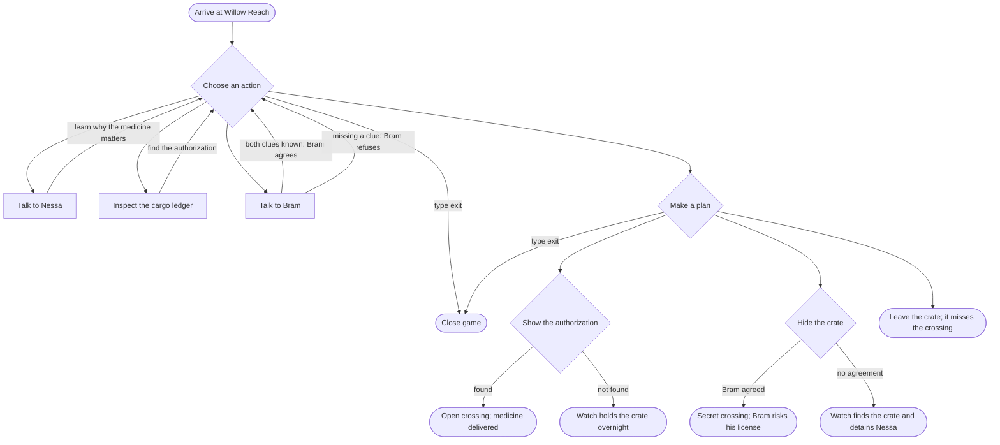

# The Last Ferry

A small, original branching RPG encounter written in Python's standard library. It explores how a few player choices can change what an NPC will risk and how the scene ends.

## Premise

You are the envoy of a hamlet cut off by floodwater. Your goal is to help Nessa get her medicine crate across the river before the storm closes the ferry. The ferry watch has flagged the crate as undeclared. Bram, the ferryman, will help only if you establish both why the crossing matters and that the crate is authorized.

At the start, the game shows a small dock map: Nessa and her crate are a few paces from you; Bram is farther up the dock at the ferry rope; the cargo ledger is beside the crate. The numbered menu makes each person and object directly interactable. You can gather information in any order, talk to the characters again, then choose an official crossing, a risky hidden crossing, or leaving the crate behind.

## Run it

Requires Python 3.10 or newer. No third-party packages are needed.

```bash
python3 last_ferry.py
```

At either menu, type `exit` to close the game. The option to leave the crate behind is a story decision; `exit` closes the program.

## How the scene works

- A `while` loop keeps the player at the dock while they investigate.
- Three state flags track what the player learned and whether Bram agreed to help.
- Dialogue changes after information is discovered, so revisiting a character has a purpose.
- Input tips show the accepted choices at both menus.
- The final decision checks the state and leads to distinct consequences.



## Try these paths

- **Official crossing:** talk to Nessa, inspect the ledger, then show the authorization.
- **Secret crossing:** talk to Nessa, inspect the ledger, talk to Bram, then hide the crate.
- **Risky choice:** skip the investigation and try to hide the crate.

## Design intent

The information-gathering loop is open-ended: the player can investigate in either order and return to earlier conversations. The ending is a commitment. The official route rewards evidence; the hidden route rewards understanding the stakes and earning Bram's trust, while exposing him to a personal cost.
